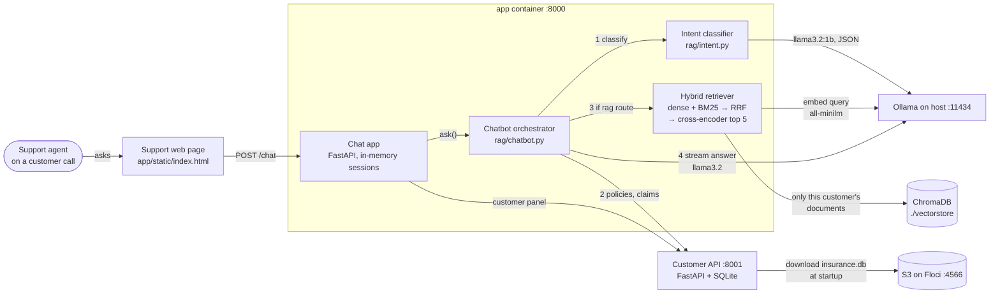
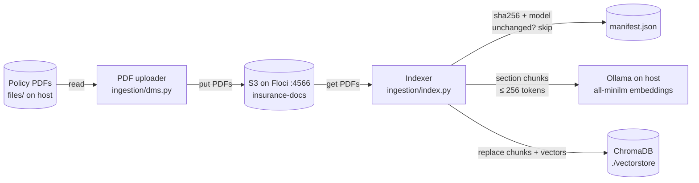
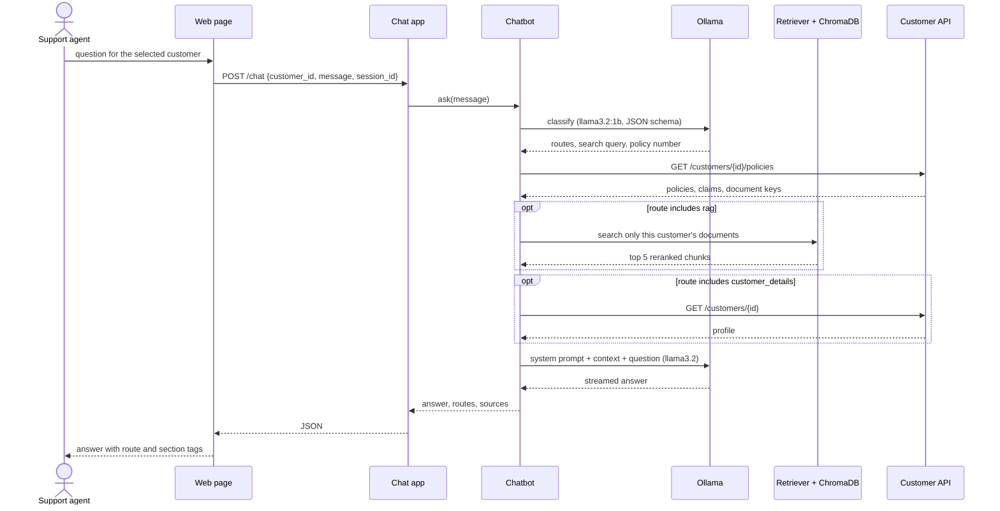

# Insurance Support Assistant

An internal chatbot for an insurance company's customer-support team. While helping a customer on a call or chat, the agent selects that customer and asks questions such as *"Is the policy active?"*, *"What is the waiting period for diabetes?"* or *"What is the status of the claim?"*. The bot answers from the customer's own policy document and their policy and claim records, and shows which policy sections it used.

Everything runs locally: the models run in [Ollama](https://ollama.com), and [Floci](https://floci.io) emulates S3.

## How it works

### Architecture: answering a question

The `app` container holds the chat API and the whole RAG pipeline in one process. Ollama runs on the host, outside Docker.



### Architecture: loading policy documents

The `indexer` service is a one-off Compose job (`docker compose run --rm indexer`). It runs the uploader, then the indexer.



### One question, step by step



GitHub Actions sits outside these diagrams. `ci.yml` lints, tests (with Floci) and builds the image. `eval.yml` scores routing, retrieval and answers. `deploy.yml` runs `scripts/deploy.sh` on the server over SSH.

- **Ingestion.** PDFs are uploaded to S3. Each one is hashed, and an unchanged document is never re-embedded. Changing the embedding model re-embeds everything. Documents are split at their numbered section and lettered subsection headings, which are detected by font size and weight. Each chunk is at most 256 tokens and is stored in ChromaDB.
- **Retrieval.** Dense search and BM25 keyword search each return their top 20 chunks. Reciprocal rank fusion merges the two lists, and the `ms-marco-MiniLM-L-6-v2` cross-encoder reranks the result down to 5 chunks. Search only covers the selected customer's own policy documents.
- **Routing.** A small model decides whether the question needs the policy document, the customer record, the policy/claim status, or several of these. Any question other than small talk also searches the document.
- **Answering.** The main model answers only from the retrieved text and data, cites the section, and says plainly when the information isn't there, so the agent knows to escalate.

## Project layout

| Path | What it is |
|---|---|
| `ingestion/dms.py` | Uploads `files/*.pdf` to the S3 bucket |
| `ingestion/index.py` | Hash check, chunking, embedding and indexing of everything in the bucket |
| `ingestion/chunker.py` | Section-aware PDF chunking (PyMuPDF) |
| `ingestion/vector_store.py` | Embeddings (Ollama) and the ChromaDB collection |
| `ingestion/hash_tracker.py` | The `vectorstore/manifest.json` hash manifest |
| `rag/intent.py` | Intent classifier / router |
| `rag/retriever.py` | Hybrid search, RRF and reranking |
| `rag/chatbot.py` | Builds the context and streams the answer |
| `customer_api/` | FastAPI customer and policy-status API over SQLite, with sample data |
| `app/main.py` | Chat API and web page for support agents |
| `app/cli.py` | Terminal chat for quick testing |
| `files/` | Policy PDFs (fictional specimens) |
| `vectorstore/` | ChromaDB data and the hash manifest (generated) |
| `tests/` | Unit tests, plus integration tests against Floci in `tests/integration/` |
| `evaluation/` | Question set and evaluation runner |
| `.github/workflows/` | CI, evaluation and deploy pipelines |
| `scripts/deploy.sh` | Deploy steps run on the server |

## Requirements

- Python 3.12
- [Ollama](https://ollama.com), with these models pulled:
  ```
  ollama pull llama3.2:1b
  ollama pull llama3.2:latest
  ollama pull all-minilm:l6-v2
  ```
- Docker, to run Floci (and optionally the whole stack)
- [floci-cli](https://floci.io), for running without Docker Compose

## Run locally

```powershell
# 1. Install
python -m venv venv
.\venv\Scripts\python.exe -m pip install -r requirements.txt
copy .env_example .env

# 2. Start the S3 emulator
floci aws start --detach
floci aws wait

# 3. Upload and index the policy PDFs
.\venv\Scripts\python.exe -m ingestion.dms
.\venv\Scripts\python.exe -m ingestion.index

# 4. Start the customer API (terminal 1)
.\venv\Scripts\python.exe -m uvicorn customer_api.server:app --port 8001

# 5. Start the chat app (terminal 2)
.\venv\Scripts\python.exe -m uvicorn app.main:app --port 8000
```

Open http://localhost:8000, choose a customer, and ask a question. The first answer is slower while the models load.

To chat in the terminal instead, run `.\venv\Scripts\python.exe -m app.cli`.

## Run with Docker Compose

Ollama keeps running on the host. The containers reach it at `host.docker.internal:11434`.

```powershell
floci aws stop                      # if floci-cli's instance is running, it holds port 4566
docker compose up -d --build --wait
docker compose run --rm indexer     # upload and index the PDFs
```

Then open http://localhost:8000.

## Configuration

Settings are read from `.env`; see `.env_example` for the full list.

| Variable | Default | Purpose |
|---|---|---|
| `INTENT_MODEL` | `llama3.2:1b` | Intent classifier |
| `MAIN_MODEL` | `llama3.2:latest` | Answer model |
| `EMBEDDING_MODEL` | `all-minilm:l6-v2` | Embeddings (changing it re-embeds all documents) |
| `RERANKER_MODEL` | `cross-encoder/ms-marco-MiniLM-L-6-v2` | Reranker |
| `OLLAMA_NUM_CTX` | `8192` | Context window for the answer model |
| `AWS_ENDPOINT_URL` | `http://localhost:4566` | S3 endpoint (Floci) |
| `S3_BUCKET` | `insurance-docs` | Bucket for PDFs and the database |
| `CUSTOMER_API_URL` | `http://localhost:8001` | Customer API used by the chatbot |

## Common tasks

- **Add or update a policy document:** put the PDF in `files/`, then run `ingestion.dms` and `ingestion.index` again. Unchanged documents are skipped. Then add the PDF's file name as the `document_key` of the matching policy in `customer_api/db.py`, because retrieval only searches documents linked to the customer's policies.
- **Reset the customer database:** `python -m customer_api.db` reloads the sample data and uploads it to `s3://insurance-docs/database/insurance.db`. The customer API downloads it from there at startup.
- **Rebuild the vector index:** delete `vectorstore/chroma` and `vectorstore/manifest.json`, then run `ingestion.index`.

## Tests

```powershell
.\venv\Scripts\python.exe -m pip install -r requirements-dev.txt
.\venv\Scripts\python.exe -m pytest              # all tests
.\venv\Scripts\python.exe -m ruff check .        # lint
```

The unit tests run in about 20 seconds and need no Ollama, no S3 and no model downloads. Models, S3 and the vector store are replaced by small offline fakes in `tests/helpers.py`. Together they cover:

- **Chunking:** heading detection, header and footer removal, token limits, and the real policy PDFs.
- **Indexing:** the hash check (new, unchanged, updated and removed documents, an embedding-model change, a wiped store).
- **Retrieval:** customer isolation, RRF and BM25.
- **Routing:** the intent post-processing rules.
- **Context and answers:** how the context is built and how answers are streamed.
- **The two APIs.**

The tests in `tests/integration/` use a real Floci S3 (`AWS_ENDPOINT_URL`). They are skipped when Floci isn't running. In CI, `REQUIRE_INTEGRATION=1` turns that skip into a failure.

## Evaluation

`evaluation/dataset.json` holds 22 questions with answers checked against the policy PDFs and the sample data. The evaluation scores each stage separately, so a drop can be traced to its cause:

| Stage | Metric | Pass threshold |
|---|---|---|
| Routing | Share of questions where the classifier picks the expected routes | 0.85 |
| Retrieval | Expected section in the top 5 (hit@5) / mean reciprocal rank | 0.90 / 0.85 |
| Answer | Share of answers containing every expected fact | 0.80 |
| Isolation | Answers citing another customer's document | 0 |

Two of the questions have no answer in the customer's documents, so the bot passes them only by saying the information isn't available rather than inventing it.

Running it needs Ollama, an indexed vector store and the customer API:

```powershell
.\venv\Scripts\python.exe -m evaluation.run_eval                              # everything (several minutes on CPU)
.\venv\Scripts\python.exe -m evaluation.run_eval --stages routing,retrieval   # fast, no answer generation
.\venv\Scripts\python.exe -m evaluation.run_eval --resume                     # continue after a crash
```

Current baseline: routing 0.91, retrieval hit@5 1.00 (MRR 0.96), answers 0.90, about 28 seconds per answer on CPU. The full run loads three Ollama models plus the reranker, so close other copies of the app first. On a 32 GB laptop with several servers open it ran out of memory part-way. `--resume` keeps the finished cases.

The report is written to `evaluation/results/report.md`, and the command exits with an error if any score is below its threshold. Run it after changing a model, a prompt, the chunking or the retrieval settings, and add a case to the dataset whenever an agent reports a wrong answer.

## CI/CD (GitHub Actions)

| Workflow | When it runs | What it does |
|---|---|---|
| `ci.yml` | Every push to `main` and every pull request | Ruff lint; all tests, with Floci as a service container; Compose validation and image build |
| `eval.yml` | On demand (Actions > Evaluation > Run workflow) and Mondays 03:00 UTC | Installs Ollama, indexes the PDFs, runs the evaluation, and attaches the report to the run |
| `deploy.yml` | After CI passes on `main`, or on demand | Connects to the server over SSH and runs `scripts/deploy.sh` (check out the tested commit, rebuild, re-index, smoke-test) |

Deploy stays switched off until you set the `DEPLOY_*` secrets listed at the top of `deploy.yml`. The server needs a clone of this repo at `DEPLOY_PATH`, Docker, and Ollama listening on an address the containers can reach (`OLLAMA_HOST=0.0.0.0`). To approve each deploy by hand, add required reviewers to the `production` environment under Settings > Environments.

## Sample customers

| Customer ID | Name | Situation |
|---|---|---|
| `CUST-88274615` | Rohan Vikram Mehta | Health policy, active (policy PDF available) |
| `MSG-CU-30419277` | Sneha Prakash Iyer | Home policy, active, with a claim under review (policy PDF available) |
| `CUST-10000001` | Priya Sharma | Motor policy in its grace period, premium overdue |
| `CUST-10000002` | Amit Verma | Life policy, lapsed |

All names, policies and documents are fictional.

## Limitations

This is a demo. Before it is used with real customer data:

- There is no login. Put it behind company sign-in (SSO) or a VPN, and log which agent looked up which customer.
- Chat sessions live in memory, so run a single app process.
- The customer database is a read-only SQLite file. Replace it with the real policy system or a proper database.
- Replace Floci with real S3, accessed through an IAM role.
